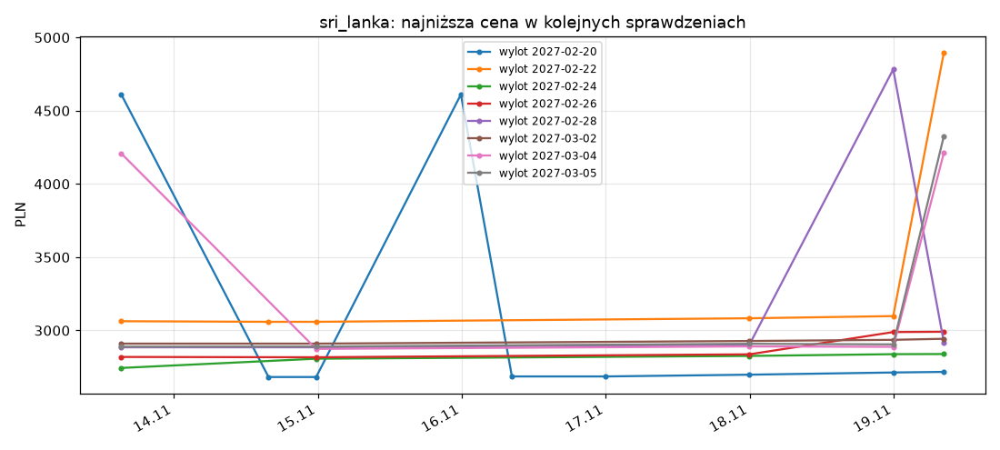

# Raport cen lotów: Polska/Praga → Sri Lanka / Wietnam (powrót do Krakowa)

Ostatnie sprawdzenie: **2026-11-20 08:20** (czas PL) · liczba sprawdzeń: 14 · od 2026-11-14

## TOP z ostatniego sprawdzenia

| # | Cena | Trasa | Daty | Linie | Przesiadki |
|---|---|---|---|---|---|
| 1 | 2 717 PLN | KRK→CMB | 2027-02-20 ↔ 2027-03-12 (powrót do KRK) | Air Arabia | 1 |
| 2 | 2 734 PLN | KRK→CMB | 2027-02-20 ↔ 2027-03-12 (powrót do KRK) | Air Arabia | 1 |
| 3 | 2 839 PLN | KRK→CMB | 2027-02-24 ↔ 2027-03-16 (powrót do KRK) | Air Arabia | 1 |

## Najtaniej teraz – osobno dla każdego kraju

**sri_lanka** – najtaniej z Krakowa: 2 717 PLN

| Cena | Trasa | Daty | Linie | Przesiadki |
|---|---|---|---|---|
| 2 717 PLN | KRK→CMB | 2027-02-20 ↔ 2027-03-12 (powrót do KRK) | Air Arabia | 1 |
| 2 734 PLN | KRK→CMB | 2027-02-20 ↔ 2027-03-12 (powrót do KRK) | Air Arabia | 1 |
| 2 839 PLN | KRK→CMB | 2027-02-24 ↔ 2027-03-16 (powrót do KRK) | Air Arabia | 1 |

**wietnam** – najtaniej z Krakowa: 3 610 PLN

| Cena | Trasa | Daty | Linie | Przesiadki |
|---|---|---|---|---|
| 3 610 PLN | KRK→SGN | 2027-03-02 ↔ 2027-03-22 (powrót do KRK) | KLM, Vietnam Airlines | 2 |
| 3 641 PLN | KRK→SGN | 2027-03-02 ↔ 2027-03-22 (powrót do KRK) | KLM, Malaysia Airlines | 2 |
| 3 646 PLN | KRK→SGN | 2027-03-02 ↔ 2027-03-22 (powrót do KRK) | KLM, Singapore Airlines | 2 |

## 3 najniższe ceny każdego dnia (ostatnie 14 dni, ze wszystkich sprawdzeń)

| Dzień | 1. | 2. | 3. |
|---|---|---|---|
| 2026-11-20 | 2 717 PLN KRK→CMB 2027-02-20 | 2 734 PLN KRK→CMB 2027-02-20 | 2 839 PLN KRK→CMB 2027-02-24 |
| 2026-11-19 | 2 713 PLN KRK→CMB 2027-02-20 | 2 731 PLN KRK→CMB 2027-02-20 | 2 838 PLN KRK→CMB 2027-02-24 |
| 2026-11-18 | 2 698 PLN KRK→CMB 2027-02-20 | 2 715 PLN KRK→CMB 2027-02-20 | 2 826 PLN KRK→CMB 2027-02-24 |
| 2026-11-17 | 2 686 PLN KRK→CMB 2027-02-20 | 2 703 PLN KRK→CMB 2027-02-20 | 3 440 PLN KRK→CMB 2027-02-20 |
| 2026-11-16 | 4 611 PLN WAW→CMB 2027-02-20 | 4 860 PLN WAW→CMB 2027-02-20 | 4 860 PLN WAW→CMB 2027-02-20 |
| 2026-11-15 | 2 682 PLN KRK→CMB 2027-02-20 | 2 699 PLN KRK→CMB 2027-02-20 | 2 807 PLN KRK→CMB 2027-02-24 |
| 2026-11-14 | 2 744 PLN KRK→CMB 2027-02-24 | 2 760 PLN KRK→CMB 2027-02-24 | 2 819 PLN KRK→CMB 2027-02-26 |

## Jak zmienia się cena (najtańsza oferta z dowolnego lotniska)

| Kraj | Wylot | Teraz | Min. widziane | Mediana | Zmiana od 1. sprawdzenia | Z Krakowa teraz |
|---|---|---|---|---|---|---|
| sri_lanka | 2027-02-20 ↔ 2027-03-12 | 2 717 PLN | 2 682 PLN | 2 698 PLN | -1 894 (-41%) | 2 717 PLN |
| sri_lanka | 2027-02-22 ↔ 2027-03-14 | 4 897 PLN | 3 059 PLN | 3 073 PLN | +1 834 (+60%) | — |
| sri_lanka | 2027-02-24 ↔ 2027-03-16 | 2 839 PLN | 2 744 PLN | 2 826 PLN | +95 (+3%) | 2 839 PLN |
| sri_lanka | 2027-02-26 ↔ 2027-03-18 | 2 991 PLN | 2 817 PLN | 2 837 PLN | +172 (+6%) | 2 991 PLN |
| sri_lanka | 2027-02-28 ↔ 2027-03-20 | 2 919 PLN | 2 885 PLN | 2 903 PLN | +34 (+1%) | 2 919 PLN |
| sri_lanka | 2027-03-02 ↔ 2027-03-22 | 2 943 PLN | 2 910 PLN | 2 928 PLN | +33 (+1%) | 2 943 PLN |
| sri_lanka | 2027-03-04 ↔ 2027-03-24 | 4 212 PLN | 2 874 PLN | 2 891 PLN | +4 (+0%) | — |
| sri_lanka | 2027-03-05 ↔ 2027-03-25 | 4 327 PLN | 2 889 PLN | 2 905 PLN | +1 438 (+50%) | — |
| wietnam | 2027-02-20 ↔ 2027-03-12 | 4 475 PLN | 4 082 PLN | 4 450 PLN | -88 (-2%) | 4 907 PLN |
| wietnam | 2027-02-22 ↔ 2027-03-14 | 4 040 PLN | 4 038 PLN | 4 038 PLN | +2 (+0%) | 4 040 PLN |
| wietnam | 2027-02-24 ↔ 2027-03-16 | 3 972 PLN | 3 765 PLN | 3 970 PLN | +207 (+5%) | 3 972 PLN |
| wietnam | 2027-02-26 ↔ 2027-03-18 | 4 163 PLN | 4 134 PLN | 4 144 PLN | +29 (+1%) | 4 221 PLN |
| wietnam | 2027-02-28 ↔ 2027-03-20 | 4 006 PLN | 3 798 PLN | 3 799 PLN | +207 (+5%) | 4 006 PLN |
| wietnam | 2027-03-02 ↔ 2027-03-22 | 3 610 PLN | 3 606 PLN | 3 610 PLN | -189 (-5%) | 3 610 PLN |
| wietnam | 2027-03-04 ↔ 2027-03-24 | 3 941 PLN | 3 779 PLN | 3 779 PLN | +162 (+4%) | 3 941 PLN |
| wietnam | 2027-03-05 ↔ 2027-03-25 | 3 897 PLN | 3 894 PLN | 3 894 PLN | +3 (+0%) | 3 897 PLN |

## Czy godzina sprawdzenia ma znaczenie?

Średnie odchylenie od mediany danej trasy (minus = taniej):

| Godzina (PL) | Odchylenie | Liczba pomiarów |
|---|---|---|
| 08:00 | +9.9% | 18 |
| 15:00 | +5.6% | 20 |
| 23:00 | +2.6% | 51 |

## Cena a liczba dni do wylotu

| Dni do wylotu | Średnia cena | Pomiary |
|---|---|---|
| 105–111 | 3 468 PLN | 26 |
| 98–104 | 3 574 PLN | 38 |
| 91–97 | 3 649 PLN | 25 |
