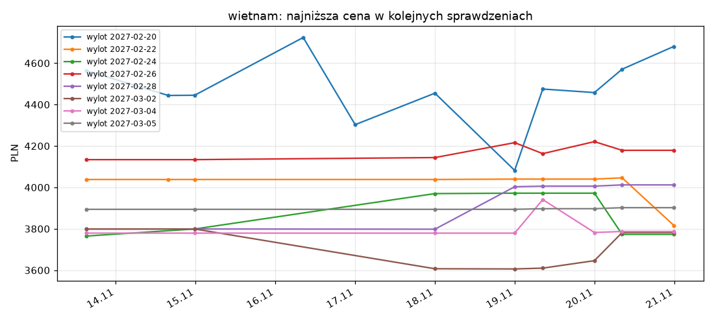

# Raport cen lotów: Polska/Praga → Sri Lanka / Wietnam (powrót do Krakowa)

Ostatnie sprawdzenie: **2026-11-21 23:45** (czas PL) · liczba sprawdzeń: 17 · od 2026-11-14

## TOP z ostatniego sprawdzenia

| # | Cena | Trasa | Daty | Linie | Przesiadki |
|---|---|---|---|---|---|
| 1 | 2 727 PLN | KRK→CMB | 2027-02-20 ↔ 2027-03-12 (powrót do KRK) | Air Arabia | 1 |
| 2 | 2 745 PLN | KRK→CMB | 2027-02-20 ↔ 2027-03-12 (powrót do KRK) | Air Arabia | 1 |
| 3 | 2 855 PLN | KRK→CMB | 2027-02-24 ↔ 2027-03-16 (powrót do KRK) | Air Arabia | 1 |

## Najtaniej teraz – osobno dla każdego kraju

**sri_lanka** – najtaniej z Krakowa: 2 727 PLN

| Cena | Trasa | Daty | Linie | Przesiadki |
|---|---|---|---|---|
| 2 727 PLN | KRK→CMB | 2027-02-20 ↔ 2027-03-12 (powrót do KRK) | Air Arabia | 1 |
| 2 745 PLN | KRK→CMB | 2027-02-20 ↔ 2027-03-12 (powrót do KRK) | Air Arabia | 1 |
| 2 855 PLN | KRK→CMB | 2027-02-24 ↔ 2027-03-16 (powrót do KRK) | Air Arabia | 1 |

**wietnam** – najtaniej z Krakowa: 3 773 PLN

| Cena | Trasa | Daty | Linie | Przesiadki |
|---|---|---|---|---|
| 3 773 PLN | KRK→SGN | 2027-02-24 ↔ 2027-03-16 (powrót do KRK) | KLM, Vietnam Airlines | 2 |
| 3 782 PLN | KRK→SGN | 2027-03-02 ↔ 2027-03-22 (powrót do KRK) | KLM, Vietnam Airlines | 2 |
| 3 787 PLN | KRK→SGN | 2027-03-04 ↔ 2027-03-24 (powrót do KRK) | Emirates, flydubai | 1 |

## 3 najniższe ceny każdego dnia (ostatnie 14 dni, ze wszystkich sprawdzeń)

| Dzień | 1. | 2. | 3. |
|---|---|---|---|
| 2026-11-21 | 2 727 PLN KRK→CMB 2027-02-20 | 2 745 PLN KRK→CMB 2027-02-20 | 2 855 PLN KRK→CMB 2027-02-24 |
| 2026-11-20 | 2 717 PLN KRK→CMB 2027-02-20 | 2 734 PLN KRK→CMB 2027-02-20 | 2 839 PLN KRK→CMB 2027-02-24 |
| 2026-11-19 | 2 713 PLN KRK→CMB 2027-02-20 | 2 731 PLN KRK→CMB 2027-02-20 | 2 838 PLN KRK→CMB 2027-02-24 |
| 2026-11-18 | 2 698 PLN KRK→CMB 2027-02-20 | 2 715 PLN KRK→CMB 2027-02-20 | 2 826 PLN KRK→CMB 2027-02-24 |
| 2026-11-17 | 2 686 PLN KRK→CMB 2027-02-20 | 2 703 PLN KRK→CMB 2027-02-20 | 3 440 PLN KRK→CMB 2027-02-20 |
| 2026-11-16 | 4 611 PLN WAW→CMB 2027-02-20 | 4 860 PLN WAW→CMB 2027-02-20 | 4 860 PLN WAW→CMB 2027-02-20 |
| 2026-11-15 | 2 682 PLN KRK→CMB 2027-02-20 | 2 699 PLN KRK→CMB 2027-02-20 | 2 807 PLN KRK→CMB 2027-02-24 |
| 2026-11-14 | 2 744 PLN KRK→CMB 2027-02-24 | 2 760 PLN KRK→CMB 2027-02-24 | 2 819 PLN KRK→CMB 2027-02-26 |

## Jak zmienia się cena (najtańsza oferta z dowolnego lotniska)

| Kraj | Wylot | Teraz | Min. widziane | Mediana | Zmiana od 1. sprawdzenia | Z Krakowa teraz |
|---|---|---|---|---|---|---|
| sri_lanka | 2027-02-20 ↔ 2027-03-12 | 2 727 PLN | 2 682 PLN | 2 715 PLN | -1 884 (-41%) | 2 727 PLN |
| sri_lanka | 2027-02-22 ↔ 2027-03-14 | 3 121 PLN | 3 059 PLN | 3 098 PLN | +58 (+2%) | 3 121 PLN |
| sri_lanka | 2027-02-24 ↔ 2027-03-16 | 2 855 PLN | 2 744 PLN | 2 838 PLN | +111 (+4%) | 2 855 PLN |
| sri_lanka | 2027-02-26 ↔ 2027-03-18 | 3 005 PLN | 2 817 PLN | 2 990 PLN | +186 (+7%) | 3 005 PLN |
| sri_lanka | 2027-02-28 ↔ 2027-03-20 | 2 934 PLN | 2 885 PLN | 2 925 PLN | +49 (+2%) | 2 934 PLN |
| sri_lanka | 2027-03-02 ↔ 2027-03-22 | 2 960 PLN | 2 910 PLN | 2 940 PLN | +50 (+2%) | 2 960 PLN |
| sri_lanka | 2027-03-04 ↔ 2027-03-24 | 2 922 PLN | 2 874 PLN | 2 918 PLN | -1 286 (-31%) | 2 922 PLN |
| sri_lanka | 2027-03-05 ↔ 2027-03-25 | 2 939 PLN | 2 889 PLN | 2 922 PLN | +50 (+2%) | 2 939 PLN |
| wietnam | 2027-02-20 ↔ 2027-03-12 | 4 681 PLN | 4 082 PLN | 4 458 PLN | +118 (+3%) | 4 758 PLN |
| wietnam | 2027-02-22 ↔ 2027-03-14 | 3 816 PLN | 3 816 PLN | 4 038 PLN | -222 (-5%) | 3 816 PLN |
| wietnam | 2027-02-24 ↔ 2027-03-16 | 3 773 PLN | 3 765 PLN | 3 884 PLN | +8 (+0%) | 3 773 PLN |
| wietnam | 2027-02-26 ↔ 2027-03-18 | 4 179 PLN | 4 134 PLN | 4 171 PLN | +45 (+1%) | 4 412 PLN |
| wietnam | 2027-02-28 ↔ 2027-03-20 | 4 012 PLN | 3 798 PLN | 4 004 PLN | +213 (+6%) | 4 012 PLN |
| wietnam | 2027-03-02 ↔ 2027-03-22 | 3 782 PLN | 3 606 PLN | 3 714 PLN | -17 (-0%) | 3 782 PLN |
| wietnam | 2027-03-04 ↔ 2027-03-24 | 3 787 PLN | 3 779 PLN | 3 780 PLN | +8 (+0%) | 3 787 PLN |
| wietnam | 2027-03-05 ↔ 2027-03-25 | 3 902 PLN | 3 894 PLN | 3 896 PLN | +8 (+0%) | 3 902 PLN |

## Czy godzina sprawdzenia ma znaczenie?

Średnie odchylenie od mediany danej trasy (minus = taniej):

| Godzina (PL) | Odchylenie | Liczba pomiarów |
|---|---|---|
| 08:00 | +8.8% | 34 |
| 15:00 | +4.7% | 20 |
| 23:00 | +1.1% | 83 |

## Cena a liczba dni do wylotu

| Dni do wylotu | Średnia cena | Pomiary |
|---|---|---|
| 105–111 | 3 464 PLN | 28 |
| 98–104 | 3 534 PLN | 62 |
| 91–97 | 3 641 PLN | 47 |
